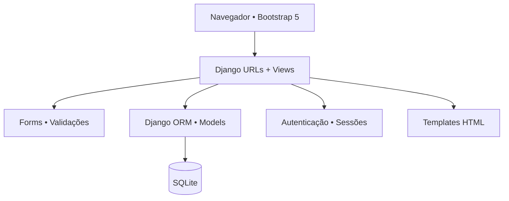
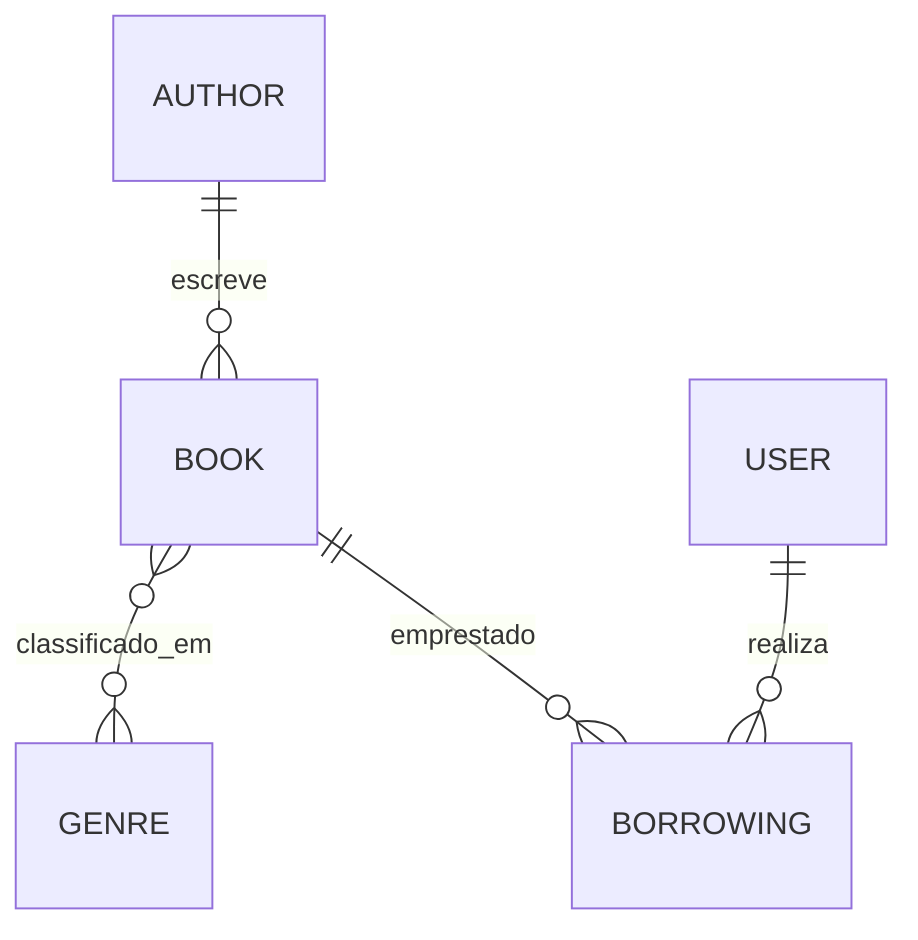

<div align="center">

# 📚 Biblioteca Digital
### Sistema de Gerenciamento de Bibliotecas

**Aplicação web para catalogar livros, gerenciar autores e gêneros e controlar empréstimos e devoluções.**


[**Funcionalidades**](#-funcionalidades) · [**Arquitetura**](#-arquitetura) · [**Capturas de tela**](#-capturas-de-tela) · [**Executar**](#-como-executar) · [**Segurança**](#-segurança-e-limitações)

</div>

---

## 🎯 Visão geral

A **Biblioteca Digital** é um projeto web desenvolvido com **Python e Django**, focado em um cenário de gestão de acervo: cadastrar livros, associá-los a autores e gêneros, consultar a disponibilidade de exemplares e registrar empréstimos e devoluções.

O sistema demonstra desenvolvimento backend em **Django MVC/MTV**, modelagem relacional com ORM, formulários, autenticação integrada, templates HTML e páginas estilizadas com **Bootstrap**.

> **Escopo:** projeto de portfólio para desenvolvimento e estudo. O código está disponível na branch [`develop`](https://github.com/WalterMatheusgg/estante-digital/tree/develop). A estrutura e funcionalidades foram verificadas no código, mas não representam homologação de produção.

## ✨ Funcionalidades

| Módulo | Recursos |
|:--|:--|
| 📚 **Livros** | Cadastro, consulta, edição e exclusão; título, autor, gêneros, descrição e quantidade no acervo |
| ✍️ **Autores** | CRUD de autores e exibição de seus livros |
| 🏷️ **Gêneros** | Cadastro, organização e gerenciamento de gêneros literários |
| 🔎 **Busca** | Pesquisa de livros por título, autor ou gênero |
| 📖 **Empréstimos** | Registro de empréstimo com prazo e conferência de exemplares disponíveis |
| ↩️ **Devoluções** | Registro de devolução pelo usuário vinculado ao empréstimo |
| 👤 **Autenticação** | Login e logout por views integradas do Django |
| 📊 **Dashboard inicial** | Quantidades de livros, autores, gêneros e empréstimos ativos |
| 🗂️ **Administração** | Administração dos modelos via Django Admin |
| 📱 **Interface** | Templates responsivos utilizando Bootstrap 5 |

### Regras de negócio observadas

- Um **livro possui um autor** e pode estar associado a **vários gêneros**.
- Cada **empréstimo** associa um livro ao usuário autenticado.
- A disponibilidade apresentada é calculada pela quantidade em estoque menos os empréstimos ativos.
- O formulário exige que o prazo de devolução não seja anterior à data atual.
- A listagem de livros utiliza paginação e buscas com Django ORM.
- Operações de alteração do acervo exigem login nas views correspondentes.

## 🏗️ Arquitetura



### Relacionamentos de dados



| Modelo | Campos principais |
|:--|:--|
| **Author** | Nome, sobrenome, nascimento |
| **Genre** | Nome único |
| **Book** | Título, autor, gêneros, estoque, descrição e URL da capa |
| **Borrowing** | Livro, usuário, data do empréstimo, prazo e data de devolução |

### Estrutura do projeto

```text
estante-digital/
├── catalog/
│   ├── management/commands/
│   │   └── seed_data.py     # Comando de carga de demonstração
│   ├── migrations/          # Migrações do banco
│   ├── models.py            # Author, Genre, Book, Borrowing
│   ├── forms.py             # Validações e formulários
│   ├── views.py             # Listagens, CRUD e empréstimos
│   ├── urls.py              # Rotas da aplicação
│   ├── admin.py             # Django Admin
│   └── tests.py             # Estrutura para testes
├── library_service/
│   ├── settings.py          # Configurações Django / SQLite
│   ├── urls.py              # Rotas de catálogo, contas e admin
│   ├── asgi.py
│   └── wsgi.py
├── templates/               # Páginas, formulários e login
├── static/css/styles.css    # Estilo personalizado
├── manage.py
├── requirements.txt
└── README.md
```

## 🖼️ Capturas de tela

Imagens já disponibilizadas na documentação original do projeto.

<div align="center">


</div>

<details>
<summary><strong>Ver o diagrama de banco de dados já publicado</strong></summary>


</details>

## 🚀 Como executar

### Pré-requisitos

- **Python 3.10 ou superior** compatível com Django 5.2.
- Git e acesso ao terminal.
- Ambiente virtual Python recomendado.

### 1. Clone o projeto

```bash
git clone -b develop https://github.com/WalterMatheusgg/estante-digital.git
cd estante-digital
```

Depois que `develop` se tornar a branch padrão, também será possível clonar sem `-b develop`.

### 2. Instale as dependências

```bash
python3 -m venv .venv
source .venv/bin/activate
python -m pip install -r requirements.txt
```

### 3. Inicialize o SQLite

```bash
python manage.py check
python manage.py migrate
```

### 4. Opcional: gere dados de demonstração

```bash
python manage.py seed_data
```

**Atenção:** o comando de demonstração cria um usuário `demo` com senha conhecida no código (`demo12345`), caso ele ainda não exista. **Use apenas em ambiente local isolado**, nunca em uma instância publicada. O comando também adiciona livros, gêneros e autores de exemplo.

### 5. Inicie o servidor

```bash
python manage.py runserver 0.0.0.0:8000
```

Em ambiente local, abra **http://127.0.0.1:8000/**. No **GitHub Codespaces**, utilize a aba **Ports** para abrir a porta encaminhada.

Para criar um administrador local, execute:

```bash
python manage.py createsuperuser
```

## 🧭 Principais rotas

| Rota | Recurso |
|:--|:--|
| `/` | Visão geral da biblioteca |
| `/books/` | Livros e busca |
| `/books/create/` | Cadastro de livro |
| `/authors/` | Autores |
| `/genres/` | Gêneros |
| `/borrowings/my/` | Empréstimos do usuário |
| `/accounts/login/` | Login |
| `/admin/` | Administração Django |

Os caminhos de detalhe, alteração e exclusão usam identificadores nas URLs. Empréstimos e devoluções são realizados via **POST**.

## 🧪 Validação e qualidade

Com as dependências instaladas:

```bash
python manage.py check
python manage.py makemigrations --check --dry-run
python manage.py test
```

O arquivo `catalog/tests.py` contém apenas o esqueleto inicial. **Não há testes automatizados de negócio implementados**; um comando de testes concluído sem falhas não comprova a cobertura de empréstimos, permissões ou regras de estoque.

## 🔒 Segurança e limitações

A configuração publicada é voltada a desenvolvimento: `DEBUG` é ativado por padrão, há uma chave de desenvolvimento como fallback e o valor padrão de `ALLOWED_HOSTS` é amplo. Para implantação externa, configure segredos privados e hosts restritos, HTTPS, permissões adequadas e banco/backup conforme os requisitos do ambiente.

**Atenção à concorrência:** a checagem de exemplares disponíveis e a criação do empréstimo não usam uma reserva transacional com bloqueio de linha; acessos simultâneos podem exigir reforço dessa regra para evitar excesso de empréstimos.

Este README documenta o estado do código encontrado, sem declarar a aplicação pronta para produção.

## 👨‍💻 Autor

**Walter Matheus Soares da Silva**  
Desenvolvedor Full Stack | Java · Spring Boot · Angular

[](https://github.com/WalterMatheusgg)
[](https://www.linkedin.com/in/walter504/)

---

<div align="center">

**Biblioteca Digital** · Gestão de acervo e empréstimos com Django.

</div>
